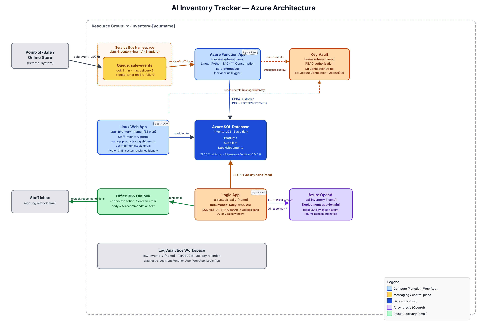

# AI Inventory Tracker — Real-Time Stock Updates with Predictive Restocking on Azure

A real-time inventory management system on Azure that decrements stock the moment a sale happens, analyzes 30 days of sales history with Azure OpenAI every morning, and emails specific restock recommendations before the business day starts.


## 🎥 Demo Video
[Watch me build this lab end-to-end →](your-loom-link-here)

## Overview

| Field | Value |
|---|---|
| Difficulty | Intermediate |
| Time to complete | 6 to 7 hours |
| IaC tool | Terraform (azurerm provider ~> 3.0) |
| Resources deployed | ~22 |
| Career relevance | Cloud Engineer, DevOps Engineer, Platform Engineer, Azure Integration Developer |

## The Business Problem This Lab Solves

Small retailers, restaurants, and service businesses share a common and expensive problem: they either run out of the things customers want most, right when demand is highest, or they tie up cash in stock that barely moves. Both problems trace back to the same root cause — inventory decisions made from manual counts and gut feel instead of data.

A reactive system says "you are running low on item A." A predictive system says "based on your sales patterns over the last 30 days, you will run out of item A in approximately three days — order 80 units from your primary supplier by Thursday." This project builds the predictive version:

- A web application on Azure App Service where staff manage products, log shipments, and set minimum stock levels
- Real-time stock count updates the moment a sale is processed, with no end-of-day reconciliation
- Daily AI analysis of 30 days of sales patterns that generates specific ordering recommendations
- Morning email delivery of those recommendations so every day starts with a clear decision list

## Why Service Bus? (The Core Design Decision)

This lab introduces a pattern not used in earlier, simpler projects: **Azure Service Bus** as a message buffer between the point-of-sale system and the inventory application.

The naive approach is to have the POS system call the web application directly every time a sale happens. The problem: if the web application is briefly unavailable — restarting, deploying, scaling — the sale event is lost and the inventory count silently drifts out of sync with reality. There's no retry, no record, no way to know it happened.

Service Bus solves this by decoupling the producer from the consumer. The POS system drops a message onto the `sale-events` queue and immediately gets confirmation that the message is safely stored, durably, on the broker. The inventory application picks up the message when it's ready, even if that's 30 seconds later. If processing fails partway through, Service Bus automatically makes the message available for retry rather than silently dropping it. No sale event is ever lost to a transient outage.

This is the pattern real production inventory, order, and payment systems use — **at-least-once delivery with a durable buffer** — and it is worth understanding deeply before walking into an interview, because "how do you avoid losing events when your service restarts" is a question that separates people who have built distributed systems from people who have only read about them.

## Architecture Overview



There are two independent flows through this system, and understanding that they're independent is the key to understanding the design:

**Flow 1 — Real-time stock decrement.** A sale happens → the sale event lands in the `sale-events` Service Bus queue → an Azure Function (triggered automatically by the queue) decrements the product's stock count in Azure SQL and logs the movement to an audit table → if the resulting stock is at or below the minimum threshold, the Function writes a warning to the logs for the next day's AI analysis to pick up.

**Flow 2 — Daily predictive restocking.** Every morning at 6:00 AM, a Logic App wakes up → queries Azure SQL for 30 days of sales history joined against current stock levels and supplier lead times → sends that data as a prompt to an Azure OpenAI `gpt-4o-mini` deployment → the model returns specific restock recommendations → the Logic App emails those recommendations to the owner via Office 365 Outlook before the store opens.

A separate Linux Web App gives staff a day-to-day portal for managing products, logging shipments, and setting minimum stock levels directly against the same database — it isn't part of either automated flow, it's the manual front door into the same data.

| Component | Role |
|---|---|
| Resource Group (`rg-inventory-[yourname]`) | Logical container for every resource in this lab |
| Azure SQL Database (`InventoryDB`, Basic tier) | Source of truth: `Products`, `Suppliers`, `StockMovements` tables |
| Linux Web App (B1 plan) | Internal staff portal for managing products, shipments, and thresholds |
| Service Bus Namespace (Standard) + `sale-events` queue | Decouples sale events from stock updates; durable buffer with automatic retry |
| Azure Function App (Linux, Python 3.10, Y1 Consumption) | `sale_processor` — triggered by the queue, decrements stock, logs the movement |
| Azure OpenAI Account + `gpt-4o-mini` deployment | Analyzes 30 days of sales data and generates restock recommendations |
| Logic App (`la-restock-daily`) | Daily 6:00 AM workflow: read sales → call OpenAI → send email |
| Key Vault (RBAC authorization) | Stores all four secrets: SQL connection string, Service Bus connection, OpenAI key, OpenAI endpoint |
| Log Analytics Workspace (30-day retention) | Centralized diagnostic logs from the Function, Web App, and Logic App |

## A Documented Design Inconsistency

The source lab guide specifies **Python 3.11** for the Linux Web App (`site_config.application_stack.python_version`) but **Python 3.10** for the Azure Function App. Both run the same `azurerm` provider version and both are Linux-based compute, so there's no technical reason for the mismatch — it reads as a copy-paste artifact in the original lab material rather than an intentional choice. Per my own standing practice, I'm flagging it here rather than silently correcting the source: if you're deploying this yourself, pick one Python version (3.11 is the more current choice) and use it consistently across both `site_config` blocks.

## Skills Demonstrated

| Skill | Real-world application |
|---|---|
| Event-driven architecture with a message broker | Decouples unreliable or bursty producers from consumers; prevents data loss during deploys or scaling events |
| Azure Service Bus queues (lock duration, max delivery count, dead-lettering) | The exact retry and poison-message handling pattern used by production messaging systems |
| Azure Functions with a `serviceBusTrigger` binding | Serverless event processing — pay only when messages actually arrive |
| Managed identity + Key Vault (RBAC model) | Secretless authentication between app and secret store; no credentials in app settings or code |
| Azure OpenAI deployment and prompt construction from live SQL data | Applying generative AI to a real operational decision, not just a chatbot demo |
| Logic Apps for low-code workflow orchestration | Connecting SQL, HTTP, and Office 365 without writing or hosting custom orchestration code |
| Transactional SQL updates with an audit trail | `UPDATE` + `INSERT` inside one logical unit of work, with a `StockMovements` table that makes every change traceable |
| Two-stage deployment (Terraform for infra, `az functionapp deployment` for code) | The real-world split between infrastructure-as-code and application code delivery |

## Deployment Walkthrough

### 1. Prerequisites
Azure OpenAI access (subject to Microsoft's approval process), plus Terraform and the Azure CLI already installed and authenticated (`az login`).

### 2. Folder structure
```
inventory-tracker-001/
├── main.tf
├── variables.tf
├── outputs.tf
├── terraform.tfvars
└── function_app/
    ├── process_sale.py
    ├── requirements.txt
    └── function.json
```

### 3. `variables.tf`
```hcl
variable "yourname" {
  type = string
}

variable "location" {
  type    = string
  default = "East US"
}

variable "sql_admin_login" {
  type    = string
  default = "sqladmin"
}

variable "sql_admin_password" {
  type      = string
  sensitive = true
}

variable "alert_email" {
  description = "Email address to receive daily restock recommendations."
  type        = string
}

variable "tags" {
  type = map(string)
  default = {
    project    = "inventory-tracker"
    managed_by = "terraform"
  }
}
```

### 4. `terraform.tfvars` (not committed — see `.gitignore` below)
```hcl
yourname            = "charles"
location            = "East US"
sql_admin_login      = "sqladmin"
sql_admin_password   = "YourSecureP@ssw0rd!"
alert_email          = "your.email@example.com"
```

> **Security note:** `terraform.tfvars` contains a plaintext SQL admin password. `sensitive = true` on the variable keeps it out of Terraform's console output, but it does **not** encrypt the `.tfvars` file on disk — that file must never be committed to source control. Add it to `.gitignore` before running `git init`.

### 5. Provider and resource group
```hcl
terraform {
  required_providers {
    azurerm = {
      source  = "hashicorp/azurerm"
      version = "~> 3.0"
    }
  }
}

provider "azurerm" {
  features {
    key_vault {
      purge_soft_delete_on_destroy    = true
      recover_soft_deleted_key_vaults = true
    }
  }
}

data "azurerm_client_config" "current" {}

resource "azurerm_resource_group" "main" {
  name     = "rg-inventory-${var.yourname}"
  location = var.location
  tags     = var.tags
}
```

### 6. Key Vault (RBAC-authorized, not access-policy)
```hcl
resource "azurerm_key_vault" "main" {
  name                       = "kv-inventory-${var.yourname}"
  location                   = var.location
  resource_group_name        = azurerm_resource_group.main.name
  tenant_id                  = data.azurerm_client_config.current.tenant_id
  sku_name                   = "standard"
  enable_rbac_authorization  = true
  soft_delete_retention_days = 7
  tags                       = var.tags
}

resource "azurerm_role_assignment" "kv_admin_self" {
  scope                = azurerm_key_vault.main.id
  role_definition_name = "Key Vault Administrator"
  principal_id          = data.azurerm_client_config.current.object_id
}
```

### 7. Azure SQL Server and Database
```hcl
resource "azurerm_mssql_server" "main" {
  name                         = "sql-inventory-${var.yourname}"
  resource_group_name          = azurerm_resource_group.main.name
  location                     = var.location
  version                      = "12.0"
  administrator_login          = var.sql_admin_login
  administrator_login_password = var.sql_admin_password
  minimum_tls_version           = "1.2"
  tags                          = var.tags
}

resource "azurerm_mssql_firewall_rule" "allow_azure_services" {
  name             = "AllowAzureServices"
  server_id        = azurerm_mssql_server.main.id
  start_ip_address = "0.0.0.0"
  end_ip_address   = "0.0.0.0"
}

resource "azurerm_mssql_database" "inventory" {
  name      = "InventoryDB"
  server_id = azurerm_mssql_server.main.id
  sku_name  = "Basic"
  tags      = var.tags
}

resource "azurerm_key_vault_secret" "db_connection" {
  name         = "SqlConnectionString"
  key_vault_id = azurerm_key_vault.main.id
  value        = "Server=tcp:sql-inventory-${var.yourname}.database.windows.net,1433;Database=InventoryDB;User ID=${var.sql_admin_login};Password=${var.sql_admin_password};Encrypt=True;TrustServerCertificate=False;"

  depends_on = [azurerm_role_assignment.kv_admin_self]
}
```

### 8. Service Bus namespace and queue
```hcl
resource "azurerm_servicebus_namespace" "main" {
  name                = "sbns-inventory-${var.yourname}"
  location            = var.location
  resource_group_name = azurerm_resource_group.main.name
  sku                 = "Standard"
  tags                = var.tags
}

resource "azurerm_servicebus_queue" "sale_events" {
  name         = "sale-events"
  namespace_id = azurerm_servicebus_namespace.main.id

  max_size_in_megabytes = 1024
  lock_duration           = "PT1M"
  max_delivery_count      = 3
}

resource "azurerm_key_vault_secret" "servicebus_connection" {
  name         = "ServiceBusConnection"
  key_vault_id = azurerm_key_vault.main.id
  value        = azurerm_servicebus_namespace.main.default_primary_connection_string

  depends_on = [azurerm_role_assignment.kv_admin_self]
}
```

> `sku = "Standard"` is required here — the Basic tier only supports topics, not queues. Standard runs about $0.01 per million operations, negligible at lab scale. `lock_duration = "PT1M"` means a message is locked for one minute while the Function processes it; if the Function crashes mid-processing without completing, Service Bus releases the lock and makes the message available again. `max_delivery_count = 3` means a message that fails three times in a row moves to the dead-letter queue instead of retrying forever — a holding area to inspect for persistent processing failures.

### 9. Azure OpenAI account and model deployment
```hcl
resource "azurerm_cognitive_account" "openai" {
  name                = "oai-inventory-${var.yourname}"
  location            = var.location
  resource_group_name = azurerm_resource_group.main.name
  kind                = "OpenAI"
  sku_name            = "S0"

  identity {
    type = "SystemAssigned"
  }

  tags = var.tags
}

resource "azurerm_cognitive_deployment" "gpt4o_mini" {
  name                 = "gpt-4o-mini"
  cognitive_account_id = azurerm_cognitive_account.openai.id

  model {
    format  = "OpenAI"
    name    = "gpt-4o-mini"
    version = "2024-07-18"
  }

  scale {
    type     = "Standard"
    capacity = 10
  }
}

resource "azurerm_key_vault_secret" "openai_key" {
  name         = "OpenAIApiKey"
  key_vault_id = azurerm_key_vault.main.id
  value        = azurerm_cognitive_account.openai.primary_access_key

  depends_on = [azurerm_role_assignment.kv_admin_self]
}

resource "azurerm_key_vault_secret" "openai_endpoint" {
  name         = "OpenAIEndpoint"
  key_vault_id = azurerm_key_vault.main.id
  value        = azurerm_cognitive_account.openai.endpoint

  depends_on = [azurerm_role_assignment.kv_admin_self]
}
```

### 10. App Service Plan and Linux Web App (staff portal)
```hcl
resource "azurerm_service_plan" "main" {
  name                = "asp-inventory-${var.yourname}"
  resource_group_name = azurerm_resource_group.main.name
  location            = var.location
  os_type             = "Linux"
  sku_name            = "B1"
  tags                = var.tags
}

resource "azurerm_linux_web_app" "inventory_app" {
  name                = "app-inventory-${var.yourname}"
  resource_group_name = azurerm_resource_group.main.name
  location            = var.location
  service_plan_id     = azurerm_service_plan.main.id

  identity {
    type = "SystemAssigned"
  }

  site_config {
    application_stack {
      python_version = "3.11"
    }
  }

  app_settings = {
    "KEY_VAULT_URI"        = azurerm_key_vault.main.vault_uri
    "SERVICEBUS_NAMESPACE" = azurerm_servicebus_namespace.main.name
    "SERVICEBUS_QUEUE"     = azurerm_servicebus_queue.sale_events.name
  }

  tags = var.tags
}

resource "azurerm_role_assignment" "app_kv_reader" {
  scope                = azurerm_key_vault.main.id
  role_definition_name = "Key Vault Secrets User"
  principal_id          = azurerm_linux_web_app.inventory_app.identity[0].principal_id
}
```

### 11. Function App — sale event processor
```hcl
resource "azurerm_storage_account" "functions" {
  name                     = "stfninventory${var.yourname}"
  resource_group_name      = azurerm_resource_group.main.name
  location                 = var.location
  account_tier             = "Standard"
  account_replication_type = "LRS"
  tags                     = var.tags
}

resource "azurerm_service_plan" "functions" {
  name                = "asp-fn-inventory-${var.yourname}"
  resource_group_name = azurerm_resource_group.main.name
  location            = var.location
  os_type             = "Linux"
  sku_name            = "Y1"
  tags                = var.tags
}

resource "azurerm_linux_function_app" "sale_processor" {
  name                       = "func-inventory-${var.yourname}"
  resource_group_name        = azurerm_resource_group.main.name
  location                   = var.location
  storage_account_name       = azurerm_storage_account.functions.name
  storage_account_access_key = azurerm_storage_account.functions.primary_access_key
  service_plan_id            = azurerm_service_plan.functions.id

  site_config {
    application_stack {
      python_version = "3.10"
    }
  }

  app_settings = {
    "SqlConnectionString"     = "@Microsoft.KeyVault(VaultName=kv-inventory-${var.yourname};SecretName=SqlConnectionString)"
    "ServiceBusConnection"    = azurerm_servicebus_namespace.main.default_primary_connection_string
    "FUNCTIONS_WORKER_RUNTIME" = "python"
    "WEBSITE_RUN_FROM_PACKAGE" = "1"
    "AzureWebJobsStorage"      = azurerm_storage_account.functions.primary_connection_string
  }

  identity {
    type = "SystemAssigned"
  }

  tags = var.tags
}

resource "azurerm_role_assignment" "func_kv_reader" {
  scope                = azurerm_key_vault.main.id
  role_definition_name = "Key Vault Secrets User"
  principal_id          = azurerm_linux_function_app.sale_processor.identity[0].principal_id
}
```

> **Note on the mixed secret pattern:** the Function reads `SqlConnectionString` via a Key Vault reference (`@Microsoft.KeyVault(...)`) resolved by the App Service platform itself, but reads `ServiceBusConnection` as a raw connection string injected directly into app settings. Both work, but they aren't the same trust model — the Key Vault reference never puts the live secret value in the portal's app settings blade; the raw connection string does. This inconsistency is in the source material and is worth normalizing (to Key Vault references for both) in a production build.

### 12. Logic App — daily AI analysis and email
```hcl
resource "azurerm_logic_app_workflow" "daily_recommendations" {
  name                = "la-restock-daily-${var.yourname}"
  location            = var.location
  resource_group_name = azurerm_resource_group.main.name
  tags                = var.tags
}
```

The workflow itself (trigger, SQL action, HTTP action, and the Outlook send-email action) is built in the Logic App Designer in the portal after `terraform apply` — see Step 10 below.

### 13. Log Analytics Workspace
```hcl
resource "azurerm_log_analytics_workspace" "main" {
  name                = "law-inventory-${var.yourname}"
  location            = var.location
  resource_group_name = azurerm_resource_group.main.name
  sku                 = "PerGB2018"
  retention_in_days   = 30
  tags                = var.tags
}
```

### 14. `outputs.tf`
```hcl
output "web_app_url" {
  value = "https://${azurerm_linux_web_app.inventory_app.default_hostname}"
}

output "function_app_name" {
  value = azurerm_linux_function_app.sale_processor.name
}

output "sql_server_fqdn" {
  value = azurerm_mssql_server.main.fully_qualified_domain_name
}

output "servicebus_namespace" {
  value = azurerm_servicebus_namespace.main.name
}

output "key_vault_uri" {
  value = azurerm_key_vault.main.vault_uri
}
```

### 15. The Function code — `function_app/process_sale.py`
Triggered by every message that lands in the `sale-events` queue. Parses the sale event, decrements stock inside a transaction, records the movement in an audit table, and checks against the minimum stock threshold.

```python
import azure.functions as func
import pyodbc
import json
import os
import logging

def main(msg: func.ServiceBusMessage):
    """
    Triggered by every message that lands in the sale-events Service Bus queue.
    Parses the sale event and decrements the product's stock count in SQL.
    If stock falls below the minimum threshold, logs a warning for the daily AI analysis.
    """
    sale_event = json.loads(msg.get_body().decode("utf-8"))
    product_id = sale_event.get("product_id")
    quantity   = sale_event.get("quantity", 1)
    sale_id    = sale_event.get("sale_id", "unknown")

    logging.info(f"Processing sale {sale_id}: {quantity}x product {product_id}")

    conn_str = os.environ["SqlConnectionString"]
    conn     = pyodbc.connect(conn_str)
    cursor   = conn.cursor()

    try:
        # Decrement stock count atomically — a transaction ensures no partial
        # update if something fails mid-way
        cursor.execute("""
            UPDATE Products
            SET CurrentStock = CurrentStock - ?,
                LastSaleDate = GETUTCDATE()
            WHERE ProductId = ?
        """, quantity, product_id)

        # Record the movement in the StockMovements audit table
        cursor.execute("""
            INSERT INTO StockMovements (ProductId, MovementType, Quantity, Reference, MovedAt)
            VALUES (?, 'SALE', ?, ?, GETUTCDATE())
        """, product_id, quantity, sale_id)

        # Check if stock has dropped below the minimum threshold
        cursor.execute("""
            SELECT ProductName, CurrentStock, MinimumStock
            FROM Products
            WHERE ProductId = ?
        """, product_id)

        row = cursor.fetchone()
        if row:
            product_name, current_stock, min_stock = row
            if current_stock <= min_stock:
                logging.warning(
                    f"LOW STOCK: {product_name} | Current: {current_stock} | Minimum: {min_stock}"
                )

        conn.commit()
        logging.info(f"Stock updated for product {product_id}. Sale {sale_id} processed.")

    except Exception as e:
        conn.rollback()
        logging.error(f"Failed to process sale {sale_id}: {e}")
        raise  # Re-raising causes Service Bus to retry the message

    finally:
        cursor.close()
        conn.close()
```

`function_app/function.json`:
```json
{
  "scriptFile": "process_sale.py",
  "bindings": [
    {
      "name": "msg",
      "type": "serviceBusTrigger",
      "direction": "in",
      "queueName": "sale-events",
      "connection": "ServiceBusConnection",
      "isSessionsEnabled": false
    }
  ]
}
```

`isSessionsEnabled = false` means messages are processed in arrival order without session-based grouping — correct for a simple FIFO queue like this one.

`function_app/requirements.txt`:
```
pyodbc==4.0.39
azure-servicebus==7.11.4
```

### 16. Deploy the infrastructure
```bash
terraform init
terraform plan
terraform apply
```
Expect approximately **22 resources to add**. Deployment takes 5 to 8 minutes, mostly due to SQL and Service Bus provisioning.

### 17. Create the database schema
In the portal, navigate to `InventoryDB` → **Query editor**, log in with the SQL admin credentials, and run in order:

**Block 1 — create tables:**
```sql
CREATE TABLE Products (
    ProductId    INT IDENTITY(1,1) PRIMARY KEY,
    ProductName  NVARCHAR(200) NOT NULL,
    SKU          NVARCHAR(50) UNIQUE,
    CurrentStock INT DEFAULT 0,
    MinimumStock INT DEFAULT 10,
    UnitCost     DECIMAL(10,2),
    SupplierId   INT,
    LastSaleDate DATETIME2,
    CreatedAt    DATETIME2 DEFAULT GETUTCDATE()
);

CREATE TABLE Suppliers (
    SupplierId   INT IDENTITY(1,1) PRIMARY KEY,
    SupplierName NVARCHAR(200) NOT NULL,
    ContactEmail NVARCHAR(200),
    LeadTimeDays INT DEFAULT 3
);

CREATE TABLE StockMovements (
    MovementId   INT IDENTITY(1,1) PRIMARY KEY,
    ProductId    INT REFERENCES Products(ProductId),
    MovementType NVARCHAR(20),  -- SALE | RESTOCK | ADJUSTMENT
    Quantity     INT NOT NULL,
    Reference    NVARCHAR(100),
    MovedAt      DATETIME2 DEFAULT GETUTCDATE()
);
```

**Block 2 — seed test data:**
```sql
INSERT INTO Suppliers (SupplierName, ContactEmail, LeadTimeDays)
VALUES ('Primary Supplier Co', 'orders@supplier.com', 3),
       ('Backup Supplier Inc', 'supply@backup.com', 7);

INSERT INTO Products (ProductName, SKU, CurrentStock, MinimumStock, UnitCost, SupplierId)
VALUES ('Laptop',        'LAP-001', 15, 5,  899.99, 1),
       ('Wireless Mouse','MSE-001', 8,  10, 29.99,  1),
       ('USB-C Hub',     'HUB-001', 3,  10, 49.99,  2),
       ('Monitor',       'MON-001', 12, 5,  299.99, 1),
       ('Keyboard',      'KEY-001', 20, 8,  79.99,  1);
```

**Block 3 — verify:**
```sql
SELECT p.ProductName, p.CurrentStock, p.MinimumStock, s.SupplierName
FROM Products p
JOIN Suppliers s ON p.SupplierId = s.SupplierId;
```

### 18. Deploy the Function code
```bash
cd function_app
pip3 install -r requirements.txt --target .python_packages/lib/site-packages
zip -r ../function_deploy.zip .
cd ..

az functionapp deployment source config-zip \
  --resource-group rg-inventory-charles \
  --name func-inventory-charles \
  --src function_deploy.zip
```

### 19. Test the sale event flow
```bash
az servicebus message send \
  --resource-group rg-inventory-charles \
  --namespace-name sbns-inventory-charles \
  --queue-name sale-events \
  --body '{"sale_id":"TEST-001","product_id":1,"quantity":2}'
```
Wait 30 seconds, then verify:
```sql
SELECT ProductName, CurrentStock FROM Products WHERE ProductId = 1;
```
The Laptop should show `CurrentStock = 13` (15 minus 2).

### 20. Configure the daily recommendation Logic App
1. Navigate to `la-restock-daily-[yourname]` → **Logic app designer**
2. Add trigger: **Recurrence** → Daily at 6:00 AM
3. Add step: **SQL Server** → **Execute a query**, connect to the SQL server, and run:
```sql
SELECT
    p.ProductName,
    p.CurrentStock,
    p.MinimumStock,
    p.UnitCost,
    s.SupplierName,
    s.LeadTimeDays,
    SUM(m.Quantity) AS UnitsSoldLast30Days
FROM Products p
JOIN Suppliers s ON p.SupplierId = s.SupplierId
LEFT JOIN StockMovements m
    ON p.ProductId = m.ProductId
    AND m.MovementType = 'SALE'
    AND m.MovedAt >= DATEADD(day, -30, GETUTCDATE())
GROUP BY p.ProductName, p.CurrentStock, p.MinimumStock, p.UnitCost,
         s.SupplierName, s.LeadTimeDays
ORDER BY p.CurrentStock ASC;
```
4. Add step: **HTTP** → **HTTP** (calling the OpenAI REST API directly, method `POST`, URI = the OpenAI endpoint from `terraform output`, body = a prompt constructed from the SQL results as dynamic content)
5. Add step: **Office 365 Outlook** → **Send an email** with the AI response as the body
6. Save

## Verification Checklist

- [ ] All three tables created in `InventoryDB` (`Products`, `Suppliers`, `StockMovements`)
- [ ] Test products and suppliers seeded in the database
- [ ] Service Bus namespace and `sale-events` queue exist in the portal
- [ ] Function App `func-inventory-[yourname]` exists and shows **Running**
- [ ] Test sale event processed: Laptop stock dropped from 15 to 13
- [ ] `StockMovements` table contains a row for the test sale
- [ ] Logic App runs daily and connects successfully to SQL
- [ ] Key Vault contains all four secrets: `SqlConnectionString`, `ServiceBusConnection`, `OpenAIApiKey`, `OpenAIEndpoint`

## Portfolio Screenshots

> Screenshots to add once captured — each should carry a real caption naming what it proves, not just a label.

- [ ] `01-service-bus-queue-metrics.png` — the `sale-events` queue showing message count before/after a test send
- [ ] `02-function-app-logs.png` — Application Insights or the Function's log stream showing a processed sale and the resulting `UPDATE`/`INSERT`
- [ ] `03-sql-query-editor-stock-change.png` — the before/after `SELECT` showing stock dropping from 15 to 13
- [ ] `04-logic-app-run-history.png` — a successful run of `la-restock-daily` showing all three steps (SQL → HTTP → Outlook) green
- [ ] `05-restock-email.png` — the actual morning email with AI-generated restock recommendations

## Troubleshooting

| Error | Cause | Resolution |
|---|---|---|
| Function not picking up messages | `ServiceBusConnection` setting incorrect | Check Function App → Configuration — the value must be the full connection string, not a Key Vault reference |
| `pyodbc` import error | ODBC driver not available in the Function runtime | Add `PYTHON_ENABLE_WORKER_EXTENSIONS=1` to the Function App settings |
| SQL stock count not updating | Function processed the message but the DB connection failed | Check Function App → Monitor → Invocations for error details |
| Service Bus queue shows messages accumulating | Function deployed but not starting | Redeploy the function zip and restart the Function App |
| Logic App SQL connection fails | Firewall rule not yet propagated | Wait 2 minutes and retry — the `allow_azure_services` rule can take time to take effect |

## Teardown
```bash
terraform destroy
```

## Related Labs
- **Project 4** — Azure OpenAI integration fundamentals (prerequisite for this lab's OpenAI access)
